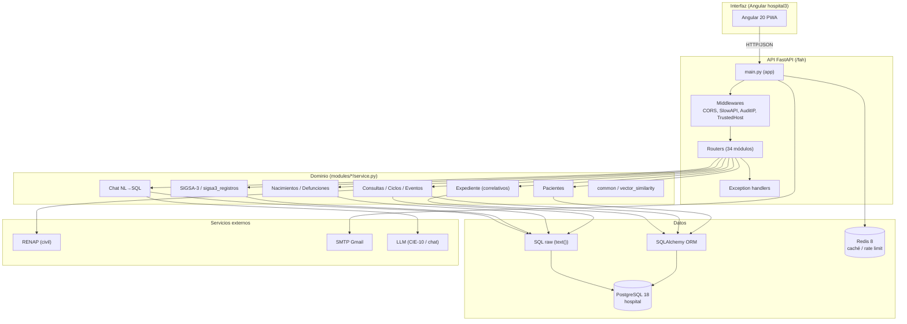
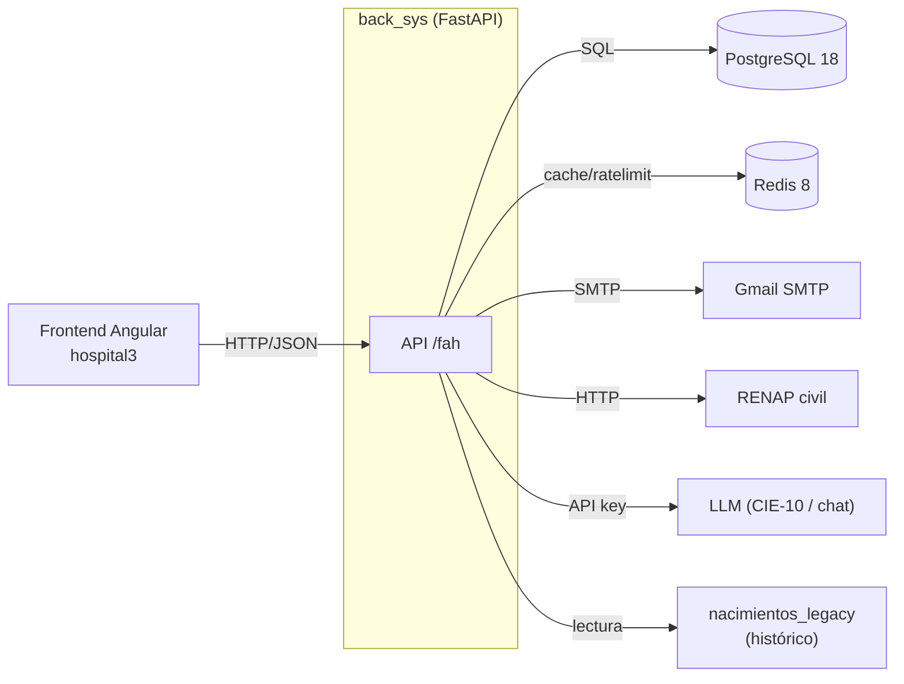
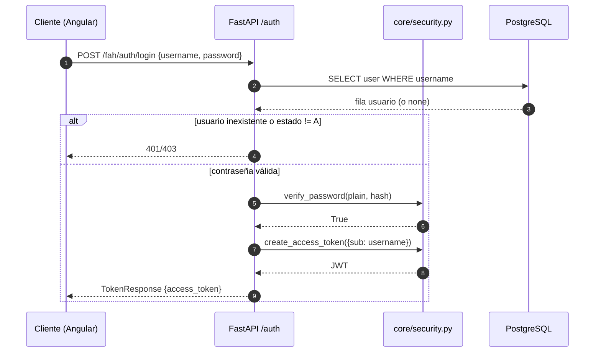
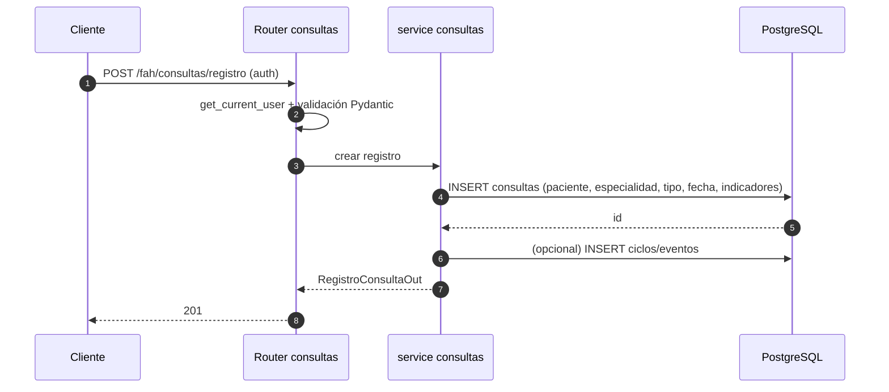
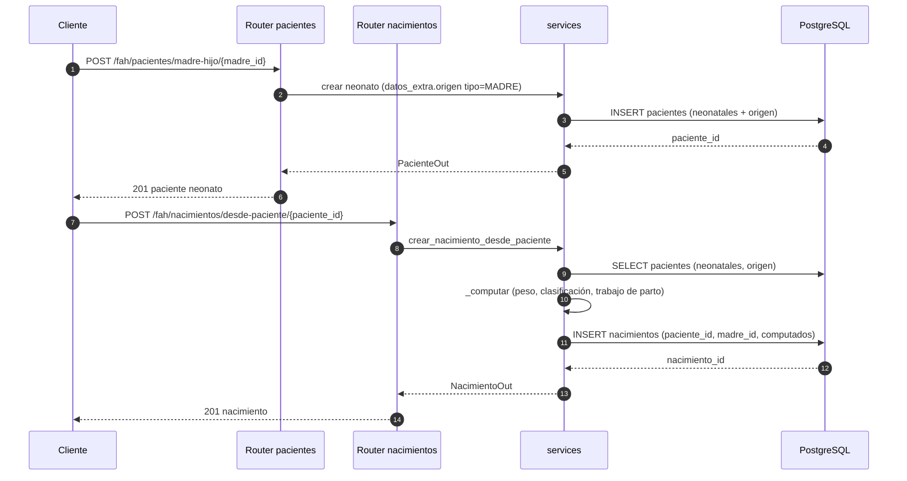
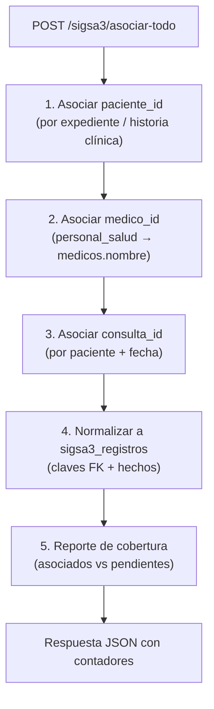
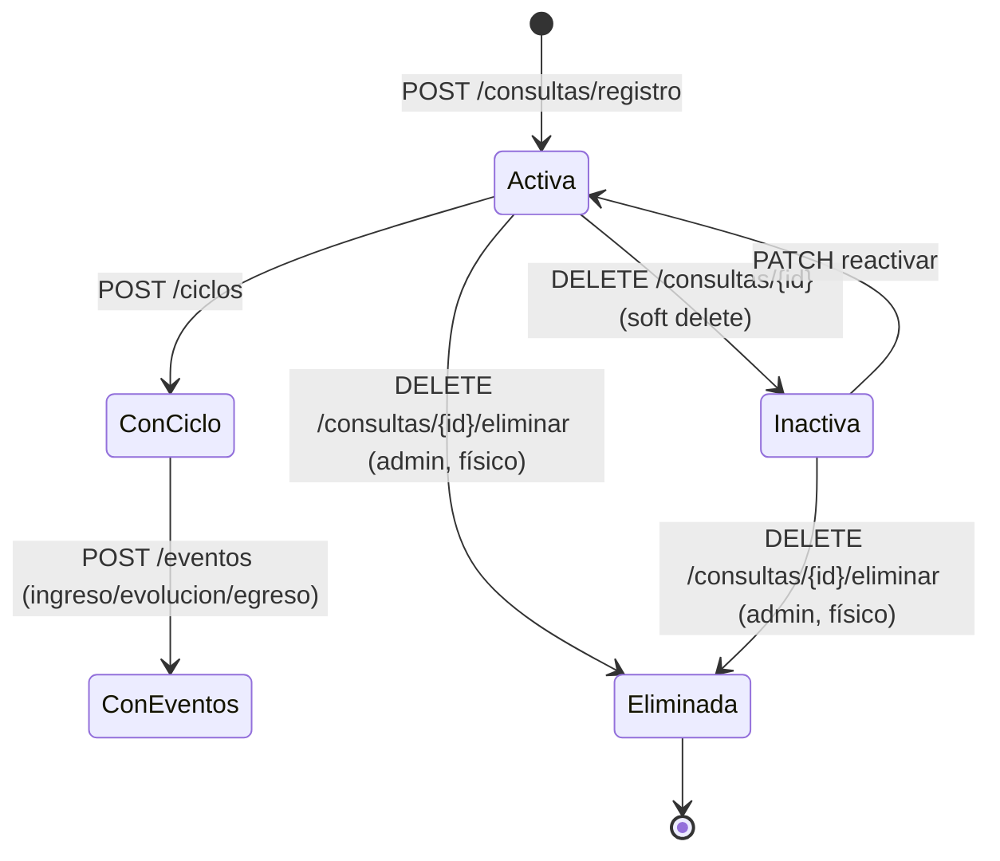

# Arquitectura del sistema `back_sys` (FastAPI + PostgreSQL)

> Documento generado con el skill `code-architect-documenter` (modo **Completo**, alcance **sistema completo**).
> Fuente de verdad: código real del repositorio (`main.py`, `core/`, `modules/`, `docs/`, `AGENTS.md`). Las afirmaciones inferidas se marcan `[Inferido]`.

---

## 0. Metadatos

| Campo | Valor |
|---|---|
| Sistema | `back_sys` — backend del Sistema FAH (Hospital General Tipo I de Tecpán) |
| Versión API | 3.0.0 (`main.py`) |
| Framework | FastAPI 0.139 (Python 3.11+; dev 3.14) |
| Servidor | Uvicorn 0.38 (workers vía gunicorn 26) |
| Base de datos | PostgreSQL 18, base `hospital` |
| ORM | SQLAlchemy 2.0 + psycopg2-binary |
| Auth | JWT (joserfc HS256) + Argon2 (passlib) |
| Validación | Pydantic 2.12 |
| Caché / rate limit | Redis 8 (fastapi-cache2 + slowapi; fallback a memoria) |
| Tests | pytest 9 + FastAPI TestClient |
| Prefijo de rutas | `/fah` (root_path) |
| Módulos | 37 paquetes en `modules/` (34 con router, 2 solo modelos) |

---

## 1. Comentarios de código inteligentes (fragmentos clave)

Fragmentos reales con docstrings que documentan el **por qué** (no se modificó la lógica).

### 1.1 `main.py` — ciclo de vida y caché compartida

```python
@asynccontextmanager
async def lifespan(app: FastAPI):
    """Inicializa la caché compartida (Redis) al arrancar y la libera al apagar.

    En producción, si Redis no responde, la app arranca en modo degradado
    (caché y rate limit en memoria por worker) pero lo deja registrado como
    error, porque sin Redis compartido los límites de tasa no son globales.
    """
    ...
    yield
    engine.dispose()
```

### 1.2 `core/security.py` — guardia global de escritura

```python
def write_guard(request: Request, db: Session = Depends(get_db)):
    """Guardia global: los métodos de escritura exigen rol >= EDITOR.

    - GET/HEAD/OPTIONS nunca se bloquean: el rol `read_only` puede leer todo.
    - Rutas exentas (login, recuperación, catálogos legacy) quedan fuera para
      no romper contratos existentes.
    - La autorización se resuelve contra la BD (fuente de verdad), no contra
      el claim del JWT, para que un usuario desactivado pierda acceso de
      inmediato aunque su token siga vigente.
    """
```

### 1.3 `core/security.py` — emisión de JWT

```python
def create_access_token(data: dict, expires_delta=None, audience=JWT_AUD_API) -> str:
    """Firma un JWT con expiración y un identificador único de emisión (jti).

    El `jti` permite revocación futura por token sin invalidar sesiones
    ajenas; hoy no se persiste, pero se reserva para auditoría.
    """
```

### 1.4 `modules/expediente/service.py` — correlativos atómicos

```python
def _generar_correlativo(db: Session, tipo: str, formato: str) -> str:
    """Incrementa el contador anual bajo bloqueo de fila (FOR UPDATE).

    No confirma la transacción: el llamador hace commit (o rollback) junto
    con el resto de su operación, para que el correlativo y el documento que
    lo usa sean atómicos. Si se confirmara aquí, un fallo posterior dejaría
    un hueco en la numeración.
    """
```

### 1.5 `modules/nacimientos/service.py` — derivación de métricas neonatales

```python
def _computar(neonatales: dict) -> dict:
    """Deriva peso en gramos, clasificación (EBP/MBP/BP/PN) y trabajo de parto
    (Prematuro / a Término / Prolongado) desde el texto crudo capturado por
    la recepción (libras/onzas, semanas gestacionales). Se reutiliza tanto al
    crear como al recomputar masivamente.
    """
```

### 1.6 `modules/nacimientos/service.py` — confianza de la evidencia

```python
def confianza_evidencias_neonatales(neonatales: dict, computado: dict) -> dict:
    """Nivel de confianza del análisis según la evidencia disponible.

    - peso + edad gestacional presentes → alta.
    - solo uno → media (la inferencia del otro queda 'sin evidencia').
    - ninguno → sin_evidencia: no se puede concluir nada.
    """
```

---

## 2. Resumen de diseño y arquitectura

### 2.1 Contexto y responsabilidad

`back_sys` es el backend del Sistema FAH de un hospital público de Guatemala (Hospital General Tipo I de Tecpán). Resuelve el registro clínico y administrativo: expedientes únicos, consultas (COEX, hospitalización, emergencia), ciclos de atención y eventos, nacimientos y defunciones, censo de camas, procedimientos, SIGSA-3 (consultas normalizadas para estadística ministerial), citas, préstamos de expedientes, catálogos (CIE-10, municipios, países), reportes y KPIs del dashboard, y un asistente NL→SQL de solo lectura. Expone una API REST consumida por el frontend Angular `hospital3`.

### 2.2 Patrón arquitectónico

**Monolito modular** (evidencia: un único proceso FastAPI, `main.py` incluye ~34 routers; módulos por dominio con `router/schemas/models/service`; BD compartida `hospital`). No hay microservicios ni bus de eventos; la integración es sincrónica HTTP→servicio→SQLAlchemy→PostgreSQL. `[Inferido]` La consistencia se logra con transacciones por operación y bloqueos de fila (`FOR UPDATE`) en correlativos.

### 2.3 Stack tecnológico

- **Lenguaje/Framework:** Python 3.11+ / FastAPI 0.139.
- **Servidor:** Uvicorn 0.38, gunicorn 26 (workers).
- **BD:** PostgreSQL 18 (`hospital`), extensiones `pg_trgm`, `unaccent`.
- **ORM:** SQLAlchemy 2.0 + psycopg2-binary.
- **Auth:** JWT HS256 (joserfc) + Argon2 (passlib), expiración configurable (default 24 h).
- **Validación:** Pydantic 2.12.
- **Email:** FastAPI-Mail (SMTP Gmail) + Jinja2.
- **Caché / rate limit:** Redis 8 (fastapi-cache2 + slowapi), degradación a memoria en dev.
- **Tests:** pytest 9 + FastAPI TestClient (requiere PostgreSQL real).
- **Paquetes:** Poetry (primario) + pip (`requirements.txt` usado por `deploy.sh`).

### 2.4 Tabla de componentes

| Componente | Capa | Responsabilidad | Depende de | Ubicación |
|---|---|---|---|---|
| `FastAPI app` | Interfaz/API | Ensambla routers, middlewares, excepciones, OpenAPI | todos los routers | `main.py` |
| `core/config.py` | Infraestructura | Variables de entorno (JWT, mail, DB, Redis, LLM) | — | `core/config.py` |
| `core/database.py` | Infraestructura | Engine SQLAlchemy, sesión, engine read-only | config | `core/database.py` |
| `core/security.py` | Dominio transversal | Hash/verify Argon2, JWT, guards RBAC | database, config | `core/security.py` |
| `core/exceptions.py` | Interfaz/API | Handlers globales (422, 409, 500) | — | `core/exceptions.py` |
| `core/limiter.py` | Infraestructura | Rate limiter compartido | Redis/memoria | `core/limiter.py` |
| `core/mail.py` | Infraestructura | Config FastAPI-Mail | config | `core/mail.py` |
| `core/db_helpers.py` | Infraestructura | Helpers `fetchone/fetchall` para SQL raw | database | `core/db_helpers.py` |
| `modules/<dominio>/router.py` | Interfaz/API | Endpoints HTTP, validación, auth | schemas, service | `modules/*/router.py` |
| `modules/<dominio>/schemas.py` | Interfaz/API | Pydantic entrada/salida | — | `modules/*/schemas.py` |
| `modules/<dominio>/models.py` | Datos | ORM SQLAlchemy | Base | `modules/*/models.py` |
| `modules/<dominio>/service.py` | Dominio | Reglas de negocio, SQL, transacciones | models, db | `modules/*/service.py` |
| `modules/chat/` | Dominio | NL→SQL read-only con LLM | database, config | `modules/chat/` |
| `modules/agente/` | Dominio | Agente/automatización | — | `modules/agente/` |
| `modules/audit_log/middleware.py` | Interfaz/API | Captura IP de cliente para auditoría | — | `modules/audit_log/middleware.py` |
| `tests/` | Calidad | pytest + TestClient | app, BD real | `tests/` |

### 2.5 Flujo de control general

1. El cliente (Angular `hospital3`) envía `HTTP/JSON` con `Authorization: Bearer <jwt>` al prefijo `/fah`.
2. `TrustedHostMiddleware`, `SlowAPIMiddleware` (rate limit), `AuditClientIPMiddleware` y `CORSMiddleware` procesan la petición.
3. `FastAPI` resuelve la ruta; la dependency global `_write_guard` exige rol ≥ EDITOR para métodos de escritura (salvo rutas exentas).
4. El router valida entrada con Pydantic y resuelve auth (`get_current_user` / `get_current_admin_user`).
5. El servicio ejecuta la lógica de negocio y SQL (ORM o `text()` raw) dentro de una sesión.
6. La transacción se confirma en el servicio (o se revierte en error); el correlativo y el documento se confirman juntos.
7. La respuesta serializada vuelve al cliente. Errores se normalizan en `core/exceptions.py`.

### 2.6 Decisiones de diseño (ADR cortos)

- **ADR-1: Monolito modular sobre microservicios.**
  - Contexto: usuarios, pacientes, consultas y transacciones compartidas.
  - Decisión: mantener un solo proceso con módulos por dominio.
  - Consecuencias: despliegue simple y consistencia local; a cambio, todo escala como una unidad y los cambios de schema afectan a toda la app.

- **ADR-2: SQLAlchemy + SQL raw mezclado.**
  - Contexto: reportes y estadísticas requieren SQL complejo (joins, agregaciones, `unaccent`).
  - Decisión: ORM para CRUD simple; `text()` raw para reportes/estadísticas.
  - Consecuencias: flexibilidad y rendimiento; riesgo de SQL disperso y duplicación de helpers (`_unaccent_ilike`, parseo de fechas).

- **ADR-3: Correlativos con bloqueo de fila y commit diferido.**
  - Contexto: numeración sin duplicados ante concurrencia.
  - Decisión: `SELECT ... FOR UPDATE` sobre tabla de control por año; el servicio no hace commit propio.
  - Consecuencias: atomicidad correlativo/documento; depende de que el llamador confirme la transacción (deuda: `generar_expediente()` hace commit interno en alta madre-hijo).

- **ADR-4: JSONB para datos flexibles (`pacientes.datos_extra`, `consultas.indicadores`).**
  - Contexto: campos socioeconómicos y banderas clínicas variables.
  - Decisión: almacenar en JSONB con índices GIN.
  - Consecuencias: evolución sin migraciones; consultas y validación menos estrictas; riesgo de claves inconsistentes (`viene_referido` vs `viene_referido_de`).

### 2.7 Seguridad y operación

- **Auth:** `POST /auth/login` → JWT (`access_token`), validado por `get_current_user`; `get_current_admin_user` restringe a `role == "admin"`.
- **RBAC:** roles `admin`, `editor`, `regular` (histórico, nivel escritura), `read_only`, más roles de dominio legados (`registro`, `uisau`, etc.) con nivel escritura. `write_guard` global bloquea escritura a `read_only`.
- **Secretos:** `.env` (no versionar en producción; deuda crítica: `.env` con secretos reales en repo).
- **Rate limit:** slowapi por IP; desactivado en tests (`RATELIMIT_ENABLED=false`).
- **Caché:** Redis compartido en producción; en dev, memoria con warnings.
- **DB:** pool SQLAlchemy (pre_ping, recycle), statement_timeout 300 s, timezone `America/Guatemala`; engine read-only opcional para chat.
- **Manejo de errores:** handlers globales; riesgo de filtrar `str(exc)`/body (PHI) — deuda media.
- **CORS/Hosts:** configurables por `.env`; laxos en dev.
- **Auditoría:** `audit_log` registra accesos (tabla, registro, endpoint, método, usuario, IP).

---

## 3. Grafo de interconexión y modelo de datos

### 3.1 Diagrama de componentes por capas



### 3.2 Modelo de datos (núcleo clínico)

```mermaid
erDiagram
  PACIENTES ||--o{ CONSULTAS : "paciente_id"
  PACIENTES ||--o{ NACIMIENTOS : "paciente_id (neonato)"
  PACIENTES ||--o{ NACIMIENTOS : "madre_id"
  PACIENTES ||--o{ CONSTANCIA_NACIMIENTO : "paciente_id / madre_id"
  PACIENTES ||--o{ DEFUNCIONES : "paciente_id"
  PACIENTES ||--o{ CITAS : "paciente_id"
  PACIENTES ||--o{ SIGSA3_REGISTROS : "paciente_id"
  PACIENTES ||--o{ PRESTAMOS : "id_paciente"

  CONSULTAS ||--o{ CICLOS_CONSULTA : "consulta_id"
  CONSULTAS ||--o{ EVENTOS_CONSULTA : "consulta_id"
  CONSULTAS ||--o{ LABORATORIOS : "consulta_id"
  CONSULTAS ||--o{ RAYOS_X : "consulta_id"
  CONSULTAS ||--o{ SIGSA3_REGISTROS : "consulta_id"
  CONSULTAS ||--o{ CONSULTAS_HISTORIAL : "consulta_id"

  ESPECIALIDADES ||--o{ MEDICOS : "especialidad_id"
  ESPECIALIDADES ||--o{ CONSULTAS : "especialidad_id"
  ESPECIALIDADES ||--o{ CICLOS_CONSULTA : "especialidad_id"
  ESPECIALIDADES ||--o{ CITAS : "especialidad_id"
  ESPECIALIDADES ||--o{ PERSONAL_SALUD : "especialidad_id"
  ESPECIALIDADES ||--o{ SIGSA3_REGISTROS : "especialidad_id"

  MEDICOS ||--o{ PERSONAL_SALUD : "medico_id"
  MEDICOS ||--o{ CONSTANCIA_NACIMIENTO : "medico_id"
  MEDICOS ||--o{ DEFUNCIONES : "medico_id"
  MEDICOS ||--o{ SIGSA3_REGISTROS : "medico_id"

  CICLOS_CONSULTA ||--o{ LABORATORIOS : "ciclo_consulta_id"
  CICLOS_CONSULTA ||--o{ RAYOS_X : "ciclo_consulta_id"

  PROCEDIMIENTOS ||--o{ PROCE_MEDICOS : "id_procedimiento"
  ENCAMAMIENTO ||--o{ CENSO_CAMAS : "servicio_id"

  USERS ||--o{ CONSTANCIA_NACIMIENTO : "registrador_id"
  USERS ||--o{ DEFUNCIONES : "registrador_id"
  USERS ||--o{ NACIMIENTOS : "registrador_id"

  CONSTANCIA_NACIMIENTO ||--o{ CONSTANCIA_NACIMIENTO_HISTORIAL : "constancia_id"
```



> Modelo completo (50 tablas, 83 FK, catálogos, insumos, control de correlativos): `docs/esquema_bd.md`.

### 3.3 Contexto del sistema (externos)



---

## 4. Procesos, secuencias y estados

### 4.1 Login



### 4.2 Alta de consulta (registro)



### 4.3 Alta de nacimiento madre-hijo



### 4.4 Asociación completa SIGSA-3 (`/sigsa3/asociar-todo`)



### 4.5 Ciclo de vida de una consulta (estados)



---

## 5. Deuda técnica, riesgos y observaciones

| # | Hallazgo | Evidencia | Severidad |
|---|---|---|---|
| 1 | `.env` con secretos reales versionado en repo remoto | `.env`, `AGENTS.md` | Crítica |
| 2 | Auto-escalada de privilegios: `PUT /users/{id}` permite asignarse `role: admin` | `modules/users/router.py:65`, `schemas.py:25` | Crítica |
| 3 | Falta rol read-only efectivo y ownership; merge/borrados físicos y `audit-log`/`GET users/{id}` solo exigen auth | `modules/pacientes/merge_router.py`, `modules/audit_log/router.py` | Alta |
| 4 | `generar_expediente()` hace `commit()` interno → rompe atomicidad en alta madre-hijo | `modules/expediente/service.py` (deuda reportada) | Alta |
| 5 | Errores filtran `str(exc)`/body (posible PHI); docs públicas; CORS/Hosts laxos | `core/exceptions.py` | Media |
| 6 | Dependencias: `pyproject.toml` declara 63 (29 transitivas mal listadas, 14 huérfanas); `pytest`/`rust_engine` no declarados; `requirements.txt` trae numpy/et-xmlfile/pillow innecesarias | `pyproject.toml`, `requirements.txt` | Media |
| 7 | Índices faltantes en `citas`, `prestamos`, `defunciones`, `audit_log`; N+1 en varios services | `docs/esquema_bd.md`, services | Media |
| 8 | Código muerto (`modules/sigsa3/implementacion/sigsa3_optimizado.py`, helpers de `chat/service.py`); duplicación de helpers (`_unaccent_ilike`, parseo de fechas, cálculo de edad) | reportado en `AGENTS.md` | Baja |
| 9 | Claves JSONB inconsistentes (`viene_referido` vs `viene_referido_de`) y `personal_hospital` como `S`/`N`/null vs booleanos | `modules/estadisticas/service.py` | Media |
| 10 | `GET /encamamiento`, `/municipios`, `/paises` son públicos (catálogos); revisar allowlist | `main.py` (write_guard exentos) | Baja |

---

## 6. Guía rápida de lectura (onboarding)

**Por dónde empezar (en orden):**

1. `main.py` — ensamblaje de la app, middlewares, routers, prefijo `/fah`.
2. `core/config.py` + `core/database.py` — configuración y conexión a PostgreSQL.
3. `core/security.py` — auth, JWT, RBAC (`write_guard`, `get_current_user`).
4. `modules/pacientes/` — CRUD, duplicados (trigram/soundex), merge, neonatos.
5. `modules/consultas/` + `modules/ciclos/` + `modules/eventos/` — ciclo de atención.
6. `modules/nacimientos/service.py` — derivación de métricas y sincronización legacy.
7. `modules/sigsa3/` + `modules/sigsa3_registros/` — normalización y asociación.
8. `modules/estadisticas/` + `modules/totales/` — reportes y KPIs.
9. `docs/esquema_bd.md` — modelo de datos completo.

**Cómo ejecutar y probar localmente:**

```bash
cd back_sys
cp .env.example .env   # completar valores
uvicorn main:app --reload          # http://localhost:8000, docs en /docs
pytest tests/ -v                   # requiere PostgreSQL 'hospital' real
```

En tests se fija `RATELIMIT_ENABLED=false` en `tests/conftest.py` antes de importar `main`.

**Glosario de dominio:**

- **Expediente:** correlativo `EXP-YYYY-######` del paciente.
- **COEX / tipo_consulta 1/2/3:** consulta externa, hospitalización, emergencia.
- **SIGSA-3:** registro normalizado de consultas para estadística ministerial.
- **Neonatales:** datos del recién nacido (peso, edad gestacional, tipo/clase de parto) en `pacientes.datos_extra`.
- **EBP/MBP/BP/PN:** clasificación por peso al nacer (extremo/muy bajo/bajo/peso normal).
- **FEFO/FIFO:** no aplican aquí; el correlativo usa bloqueo de fila.
- **Soft delete:** `estado='I'`/`activo=false` en lugar de borrado físico.

**Preguntas abiertas / `[Por confirmar]`:**

- ¿Existe un rol `read_only` funcional en producción o solo en código? `[Por confirmar]`
- ¿Se usan credenciales read-only de PostgreSQL (`POSTGRES_RO_USER`) en producción? `[Por confirmar]`
- ¿El frontend `hospital3` consume todos los 318 endpoints publicados? `[Por confirmar]`
- ¿Hay pipeline CI que valide OpenAPI y rutas públicas? `[Por confirmar]` (la rutina está documentada en `docs/arquitectura_api.md`).